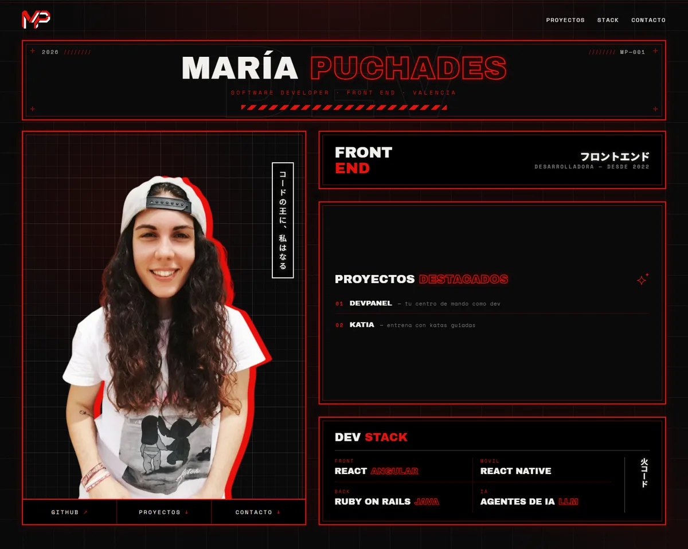

# María Puchades — Porfolio

Porfolio personal de María Puchades, desarrolladora front end. Recoge mis proyectos, cada uno con su propia página, el stack con el que trabajo y cómo contactar conmigo. El diseño es propio, con una estética inspirada en Japón y el cyberpunk: negro, rojo neón y tipografía de cartel.

**Demo:** _pendiente de enlazar_ · **Diseño:** propio



## Qué hay dentro

- **Inicio**: cabecera tipo cartel, foto, rol, proyectos destacados y stack resumido, todo en una pantalla.
- **Proyectos**: tarjetas con forma de entrada de cine; cada una abre su página.
- **Página de proyecto**: ficha técnica, tres puntos clave, comparador antes/después, capturas dentro de una ventana de navegador, enlaces a demo y código.
- **Stack** y **Contacto**.
- **404** propia, con guiño a Spider-Verse.

## Diseño

Negro y rojo, tipografía de cartel (Archivo Black) con monoespaciada de terminal (Space Mono) y rótulos en japonés. Las animaciones son pocas y a propósito: entrada escalonada, encendido de neón, cortina entre páginas y hover solo con ratón. Con `prefers-reduced-motion` quedan solo fundidos. La foto no se anima.

## Stack

- React 19 + Vite, JavaScript
- React Router para las páginas de proyecto
- CSS Modules con tokens globales (colores, fuentes, easing)
- Sin librerías de UI ni de animación: todo CSS

## Arrancar

```bash
npm install
npm run dev       # servidor de desarrollo
npm run build     # build de producción en dist/
```

## Estructura

```
src/
  pages/        Inicio, página de proyecto y 404
  components/   Un componente por carpeta: Nombre.jsx + Nombre.module.css
  data/         Contenido editable: perfil, proyectos, stack, enlaces
  hooks/        useInView, useClock, useDocumentTitle
  styles/       tokens.css, base.css, motion.css
public/         Foto, favicon y capturas de los proyectos
```

Para cambiar textos, proyectos o enlaces basta con tocar `src/data/`; los componentes no llevan contenido.

## Despliegue

Pensado para Vercel: `vercel.json` reescribe todas las rutas a `/` para que las páginas de proyecto funcionen al recargar.

---

Diseño y desarrollo de María Puchades · [GitHub](https://github.com/emepuchades) · [Instagram](https://instagram.com/puchiideev) · [Twitter](https://twitter.com/puchiiidev)
